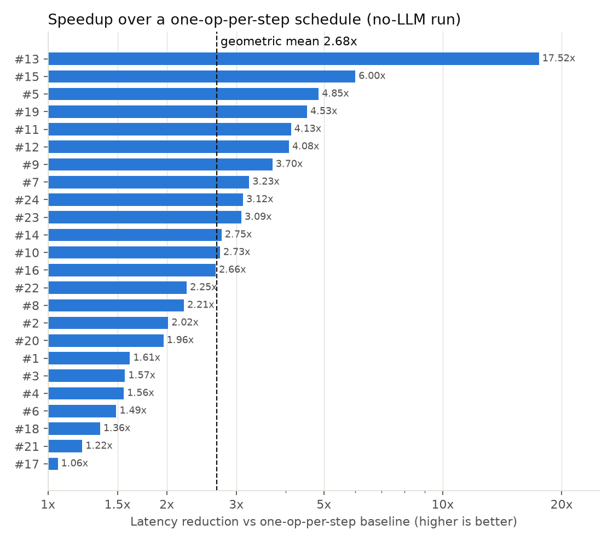
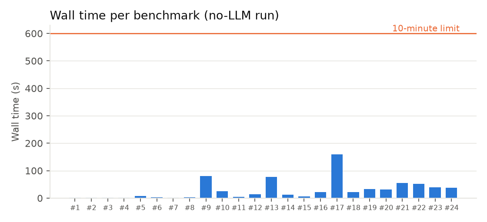

# AccelerAgent

A Gemini-powered agent that schedules tensor graphs onto an accelerator with a small
scratchpad memory. Built for Track B (Agent Reasoning) of Google's
[MLSys 2026 Graph Scheduling Competition](https://github.com/yarongmu-google/MLSys),
where it placed **12th of 32 submissions**.

The idea behind it: for most scheduling decisions the latency model already gives a clear
answer, so the agent only asks Gemini when two options are genuinely close. The
organizers' [Track B dashboard](https://github.com/yarongmu-google/MLSys/blob/main/track_b_dashboard.md)
tags every submission with its techniques, and this was the only one of the 32 whose
LLM calls are gated by local-search confidence.

## The problem

The input is a DAG of MatMul and Pointwise ops. The accelerator has a fast scratchpad of
fixed capacity and slow memory with finite bandwidth. A schedule decides which ops run
together as one step (fusion), the tile size of each step, the tile traversal order, and
which tensors stay in fast memory between steps. Latency follows a roofline model: every
tile costs `max(compute, bytes moved / bandwidth)`. The goal is the lowest total latency
without ever exceeding fast memory. Full specification:
[PROBLEM.md](https://github.com/yarongmu-google/MLSys/blob/main/PROBLEM.md).

The contest scored each benchmark as `best latency in the field / your latency`, summed
over 24 benchmarks. An invalid schedule scores zero. Agents had 10 minutes per benchmark
and could call only the Gemini API.

## How it works

```
Phase 0    Strategy     graph metrics + a probe run; one Gemini call picks a preset
                        (aggressive_fusion, balanced, conservative, memory_optimized, compute_optimized)
Phase 0.5  DP chains    optimal partition of linear op chains, skipping chains that feed a junction
Phase 1    Greedy       three restarts; each step proposes fusion and recomputation candidates,
                        scores them on the latency model, and asks Gemini only if the gate opens
Phase 2    Local search merge / split / swap / flip moves, per-step tile tuning, global DP repartition,
                        and a final all-ops mega-fusion check
```

**The confidence gate.** Gemini is skipped when the best candidate is at most 70% of the
second best's latency, when only one candidate is feasible, when the top two are the same
step, or when less than 60 seconds of budget remain. A Gemini call takes about 12 seconds
and a gated decision about 1 ms, so the budget goes to the few decisions that are actually
ambiguous. Without the gate, the 103-op benchmark needed 87 calls, close to 18 minutes.

**Memory optimizations.** Snake traversal keeps one operand resident across a sweep of
tiles. Tensor retention keeps an output in fast memory when a later step reads it, scored by
reload cost saved and how soon it is needed, within 60% of capacity. Recomputation handles
diamond patterns FlashAttention-style: recompute the producer inside each consumer, or fuse
all consumers into one step.

The March 2026 write-up in [`docs/`](docs/writeup-march-2026.pdf) covers the design
decisions and the bugs behind them.

## Results on the 24 official benchmarks

The organizers published all 24 scored benchmarks after the contest. The numbers below are
measured by this repo's scripts on those files, with the agent's deterministic fallback
(no Gemini calls), so anyone can reproduce them without an API key.

| Metric | Result |
|---|---|
| Valid schedules | 24 of 24 |
| Speedup over a one-op-per-step schedule | 2.68x geometric mean (1.06x to 17.5x) |
| Wall time | median 18 s, slowest 159 s, against a 600 s limit |
| Steps | 1,397 ops scheduled in 337 fused steps |

The baseline runs every op alone with its best tile size and traversal, keeping nothing in
fast memory. It isolates what fusion, retention and recomputation contribute.



| # | Ops | Steps | Latency | One-op-per-step | Speedup | Wall time |
|--:|--:|--:|--:|--:|--:|--:|
| 1 | 5 | 1 | 162,568 | 262,251 | 1.61x | 1 s |
| 2 | 5 | 1 | 26,000 | 52,429 | 2.02x | 1 s |
| 3 | 4 | 1 | 61,899 | 97,036 | 1.57x | 1 s |
| 4 | 5 | 1 | 20,739 | 32,284 | 1.56x | 1 s |
| 5 | 19 | 1 | 185,467 | 899,167 | 4.85x | 8 s |
| 6 | 17 | 6 | 154,714 | 230,477 | 1.49x | 4 s |
| 7 | 15 | 1 | 55,383 | 179,083 | 3.23x | 2 s |
| 8 | 20 | 4 | 50,964 | 112,659 | 2.21x | 3 s |
| 9 | 32 | 2 | 3,548,266 | 13,141,245 | 3.70x | 80 s |
| 10 | 28 | 1 | 1,728,080 | 4,713,009 | 2.73x | 26 s |
| 11 | 26 | 2 | 349,842 | 1,443,438 | 4.13x | 5 s |
| 12 | 31 | 2 | 529,227 | 2,157,347 | 4.08x | 14 s |
| 13 | 63 | 16 | 671,416 | 11,764,040 | 17.52x | 77 s |
| 14 | 63 | 9 | 511,103 | 1,407,251 | 2.75x | 13 s |
| 15 | 61 | 1 | 206,087 | 1,237,393 | 6.00x | 6 s |
| 16 | 63 | 2 | 1,167,967 | 3,106,067 | 2.66x | 22 s |
| 17 | 103 | 56 | 3,421,200 | 3,623,036 | 1.06x | 159 s |
| 18 | 96 | 2 | 279,200 | 378,394 | 1.36x | 22 s |
| 19 | 103 | 2 | 251,123 | 1,137,528 | 4.53x | 32 s |
| 20 | 103 | 50 | 800,776 | 1,570,678 | 1.96x | 31 s |
| 21 | 152 | 80 | 450,400 | 550,100 | 1.22x | 55 s |
| 22 | 150 | 75 | 389,041 | 873,813 | 2.25x | 52 s |
| 23 | 121 | 19 | 316,475 | 977,877 | 3.09x | 40 s |
| 24 | 112 | 2 | 198,030 | 617,688 | 3.12x | 38 s |

Latencies are in the contest's time units, from the roofline model in PROBLEM.md, which
`scripts/evaluate.py` recomputes and validates for every output.



### Not measured yet

- **What Gemini adds.** Every number above comes from the no-LLM fallback.
  `python3 scripts/evaluate.py --mode gemini --attempts 3` measures the Gemini run the way
  the contest did (median of 3 attempts), with the share of decisions that went to Gemini
  versus the gate, and `scripts/make_charts.py` then plots the latency difference per
  benchmark.
- **Contest-normalized score.** The dashboard publishes normalized points only for the top
  10. A per-benchmark score needs the field's best latencies, which could be approximated
  by running the open-sourced winning Track A solvers on the same files.
- **Ablations.** Turning off retention, recomputation, snake traversal and local search one
  at a time would show which optimization carries each benchmark.

## Run it

```bash
pip install -r requirements.txt
cp .env.example .env            # add your Gemini API key; without one the agent runs its fallback

python3 agent.py benchmarks/mlsys-2026-5.json out.json

python3 scripts/baseline.py                 # one-op-per-step latencies  -> results/baseline.csv
python3 scripts/evaluate.py --mode heuristic  # all 24 benchmarks, no API -> results/heuristic.csv
python3 scripts/make_charts.py              # charts in results/ (needs matplotlib)
```

## Layout

```
agent.py                  the agent (single file, as the contest required)
prompts/system_prompt.txt Gemini system prompt
benchmarks/               the 24 official problems (Apache-2.0, from the organizers)
scripts/                  evaluation, baseline and chart scripts
results/                  CSVs and charts behind this README
docs/                     contest write-up, March 2026
```

The write-up in `docs/` dates from March 2026, before mega-fusion and the structural
hints were added.

## License

MIT for the code (see [LICENSE](LICENSE)). The benchmarks in `benchmarks/` are the
organizers' and keep their Apache-2.0 license.
